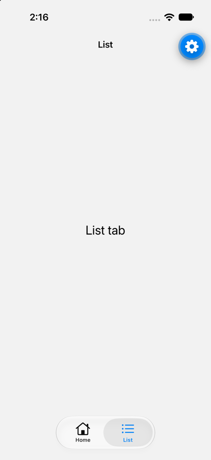
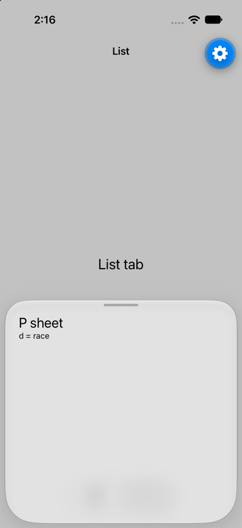

# expo-router (SDK 58): a sheet linked to in another tab while a sheet is still closing never appears, and the stack stays stuck

Minimal reproduction. SDK 58 (`expo@58.0.14`, `expo-router@58.0.23`, `react-native-screens@4.30.0`, React Native 0.88),
Expo Go on an iOS 27.0 simulator (iPhone 17).

The app is a root `Stack` anchored on a `(tabs)` group, with one `formSheet` route, `share`. The tabs are `NativeTabs`
with two groups, each with its own `Stack`: `(home)` and `(list)`. `(list)`'s stack is anchored on `list` and holds a
second `formSheet` route, `p` (detent 0.45). A logger prints the root navigation state (`NAVSTATE`) on every change.

This is the shape of a real app where a share link (`/p?d=…`) is a sheet registered in one tab's stack, so the link
selects that tab on its way in.

## Steps

```sh
bun install   # or npm install
npx expo start --ios
xcrun simctl spawn booted defaults write com.apple.launchservices.schemeapproval "com.apple.CoreSimulator.CoreSimulatorBridge-->exp" -string host.exp.Exponent
./repro.sh exp://<your LAN IP>:8081       # no pause between the root link and the /p link
```

`repro.sh` opens three links:

1. `/share`: the root form sheet appears.
2. `/?r=1` (three seconds later): back to the root. The share sheet starts closing.
3. `/p?d=race`, with no pause: the link selects the List tab and should present `p` there.

| No pause (`./repro.sh exp://… 0`) | Three-second pause (`./repro.sh exp://… 3`) |
| --- | --- |
|  |  |

## Expected

The List tab is selected and the P sheet appears over it. That is what happens when the third link is opened three
seconds after the second (`./repro.sh exp://… 3`), and when no sheet was up before (open `/?r=1`, then `/p` at once).

## Actual

The List tab is selected but **no sheet appears**. The router's state says it is there:

```
(list): {"type":"stack","index":1,"routes":["list","p"]}
```

It then stays stuck: every later link to `/p`, however far apart, leaves the state at `["list","p"]` (only the
params change) and nothing is presented, until the app is reloaded. In the real app this shows as the sheet's screen
mounting (its effects run) with no sheet on screen, for every share link after the first race.

Results (fresh load each time):

| Sequence | Sheet shown | Router state of `(list)` |
| --- | --- | --- |
| share, root, `/p` at once | no | `["list","p"]` |
| share, root, 3 s, `/p` | yes | `["list","p"]` |
| root, `/p` at once (no sheet before) | yes | `["list","p"]` |
| after the first row: root, 4 s, `/p` (twice) | no, both | `["list","p"]` |

A related variant: with the share sheet still up (no root link at all), a link to `/p` removes `share` and pushes `p`
in one update, and `p` is popped again a moment later without any navigation, so it never shows either.

## Notes

- With the JS `Tabs` navigator instead of `NativeTabs`, the `(list)` group's `anchor` is not applied, so `p` is the
  stack's only screen and is not presented as a sheet; that variant does not show whether `NativeTabs` is required.
- A bare root link (`exp://host/--/`) does not navigate in Expo Go, so the repro uses `/?r=1`. In a development
  build the app's own scheme (`myapp://`) navigates to the root as expected, and the bug reproduces the same way.
